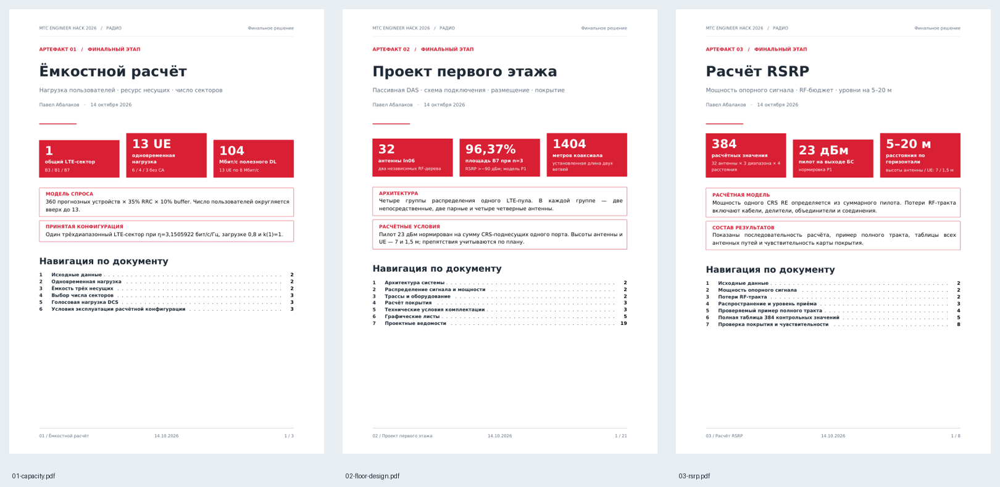

# Оформление трёх PDF

Три PDF используют единый стиль, оглавление и закладки. Их технические
значения формируются из текущей модели. Карты номинала, n=3 и запаса
содержат условия расчёта; фактические KPI этим не подтверждаются.

| Документ | Формат и организация |
| --- | --- |
| 01-capacity | A4; обзор нагрузки и выбранного пула, оглавление, последовательный расчёт и сравнение с онлайн-этапом |
| 02-floor-design | A4 для пояснений и ведомостей; 14 листов A3 для плана, схем и карт. Две схемы — альбомные, план и карты — портретные по геометрии этажа |
| 03-rsrp | A4; обзор исходных величин, математические формулы, полный пример, отдельная таблица на каждый диапазон и чувствительность |

Основной текст пояснений и подписи-абзацы к графическим листам выровнены по ширине.
Заголовки и короткие подписи карточек выровнены по левому краю.
Основной шрифт — DejaVu Sans, 11 pt. В таблицах 9,5 pt; длинная маршрутная
ведомость — 9 pt. Математические формулы набраны средствами XeLaTeX.
Тёмный текст; единый красный акцент #D82035; нейтральная серая заливка
#F2F2F2 и линии #D9D9D9. Карточки показателей красные с белым текстом;
заголовки, рамки информационных блоков и нумерация используют один красный.
Линии таблиц совпадают с краями заливки шапки. Дата оформления — 14.10.2026. Условность
результатов обозначена текстом, а не только цветом. Значения в таблицах
выровнены по столбцам; нумерация и дата одинаковы на текстовых и графических листах.

Оглавление и закладки кликабельны. План и две схемы сохраняют векторную
графику; карты поля используют исходные расчётные изображения без пересчёта.
Карты LTE сохраняют общую шкалу −110…−75 дБм. Масштаб отображения плана
зависит от просмотра и печати; координаты CAD не изменены.

На печати следует учитывать смешанные A4/A3 в проектном документе.
Уменьшение A3 до A4 уменьшает подписи; для просмотра использовать увеличение.

Редактируемые Markdown-файлы в этой папке создаёт `package_submission.py`.
Стиль — `pdf-header.tex`; оформление таблиц — `scripts/final/pdf-design.lua`;
обзоры, листы A3 и навигация — `scripts/final/pdf_design.py`.
Последующая пересборка сохраняет стиль. Обзоры читают значения из тех же
JSON, что техническая часть.

Экспорт проверяет поля, нумерацию, переходы оглавления и закладок,
векторность схем и все 384 значения RSRP в самом PDF. Эти проверки
оформления не подтверждают выполнение всех KPI задания.

## Спецификация XLSX

Все девять технических листов используют DejaVu Sans 11 pt, красную шапку с белым текстом,
нейтральные серые полосы строк и разделители. Числа выровнены вправо,
длинные текстовые ячейки — по ширине; текст переносится; заголовки закреплены, фильтры сохранены. При печати
шапка повторяется, ширина листа помещается на одну страницу A4/A3.
Дата в печатном колонтитуле — 14.10.2026. Значения и числовые форматы
сохраняются. Для точного отображения шрифт DejaVu Sans должен быть установлен.

Общее оформление ячеек — style() в build_project.py. package_submission.py
автоматически применяет его ко всем листам через format_equipment.py перед
копированием итоговой спецификации. Оригинальный перечень организаторов не изменяется.
