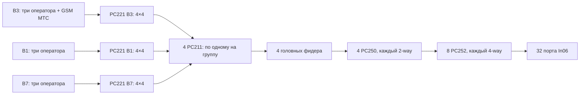

# Проект первого этажа: 32 антенны и условная проверка покрытия

Обновлено: 13.10.2026. Подготовлен проект с явно принятыми допущениями. Номинальный прогноз RSRP проходит 95% в выбранной модели, но чувствительность и неопределённая геометрия не позволяют заявить фактическое выполнение всех KPI или полное соответствие ТЗ. Уточнения организаторов недоступны и не являются условием продолжения работы.

## Геометрия и проектная ВК

Источник — оригинальный DWG из [source-materials](source-materials/README.md). INSUNITS=4: миллиметры; координаты переведены в метры без подгонки площади. Подложка сверена с исходным PNG. [Экспликация](../../design/final/room-schedule.csv) содержит 46 помещений, итог чертежа 2097,06 м², сумма округлённых строк 2097,08 м²; нагрузка по ТЗ сохраняется независимо от этой разницы.

Восстановлены 35 геометрических групп для 45 локализованных помещений. Полная площадь маски 2035,27 м², после исключения модельных колонн — немного меньше. Часть комнат соединена через проёмы или не разделяется геометрией однозначно. Сопоставление контуров и площадей опубликовано в [аудите площади](../../design/final/coverage/area-audit.csv). Это производная модель, не новое исходное условие.

Помещение 89 (45,52 м²) не локализовано и полностью считается непрошедшим покрытие. Разница 2,92 м² между суммой строк и 2100 м² тоже считается непокрытой. Близость суммарной площади маски к экспликации не подтверждает расположение 89.

Существующая ВК не найдена. В проекте выделяется зона головного узла в части магазина 104.2, CAD-точка (9,2; 31,2) м, внутри его восстановленного контура. Это собственное изменение планируемого использования части помещения, а не обнаруженная аппаратная. Питание, охлаждение, размеры оборудования и ограничения доступа не выдумываются. Выбор уменьшает длинные головные ветви; первоначальный ввод около 118 сохранён только для сравнения.

## Секторизация и размещение

Один общий LTE-пул B3/B1/B7 и один DCS-пул с двумя TRX. Четыре группы фидеров Z1–Z4 не являются четырьмя независимыми LTE-секторами. На каждой LTE-несущей антенны передают сигнал одной ячейки: собственные независимые co-channel ячейки не создаются, но внешние помехи, многолучёвость и задержки остаются.

Выбрана In06: omni MIMO, 800–2700 МГц, 3 dBi, H=360° по XLSX. Вертикальная диаграмма и port isolation не предоставлены. In08 не применяется: в строке перечня отсутствует частотный диапазон.

Из начальных 48 точек отобраны 32; сравнивались 16/24/32/48 антенн и три места источника. Предварительный отбор не заменял пересчёт настоящего дерева. Две точки в 121 и 126 перенесены на 1,5 м и проверены полным полем. Это выбранный вариант модели, не доказанный глобальный минимум. Монтажная пригодность и доступность электротехнических помещений не подтверждены.

Высота антенны 7 м и UE 1,5 м — допущения. В каждой точке сохраняются две независимые цепи до двух портов In06. Разветвление одного RF-порта не подменяет MIMO.

План с расположением антенн, зональных и подгрупповых делителей: [PDF](../../design/final/verification/final-layout.pdf), [PNG](../../design/final/verification/final-layout.png). ВК содержит 6 PC221, 8 PC211 и 1 PC250; у S/Q размещаются отдельные устройства M1/M2. Точные размеры и монтажная раскладка не заданы. [Координаты всех 71 устройств](../../design/final/verification/device-locations.csv), [координаты антенн](../../design/final/antenna-schedule.csv), [входы проекта](../../design/final/project-input.json), [расчётная структура](../../design/final/candidate.json).

## RF-схема и три оператора

Схема одной MIMO-ветви повторяется для второго порта:

Четыре выхода каждого гибрида используются в четырёх группах; соответствующие выходы B3/B1/B7 объединяются триплексером. 6 дБ PC221 уже включают передачу с входа на один из четырёх выходов: дополнительное головное 4-way деление не добавляется.

DCS-пул через отдельный PC250 делится на два B3-гибрида. Это не GSM MIMO; голосовой путь дополнительно имеет идеальные 3,01 дБ и excess loss. Общий GSM RF-выход с двумя TRX — допущение об интерфейсе БС, не подтверждённая модель оборудования. При отдельных выходах TRX требуется решение объединения. Для DCS двух других операторов отдельные входы не выделены. Совместимость DCS/LTE-1800, частоты, PIM и изоляция не доказаны одним наличием комбайнера.

Итого: 6 PC221, 8 PC211, 16 PC252, 9 PC250 (8 зональных и 1 голосовой), 32 In06. PC251 не используется. Нагрузки, мощности и платформы двух других операторов не придуманы: предусмотрены их интерфейсы, а не заявлена их ёмкость.

Свободные входы B1/B7 и ещё не подключённых операторов требуют паспортно допустимого окончания. Нагрузок 50 Ом в перечне нет; это сохраняется как ограничение комплектации. Нельзя объявлять открытые порты согласованными или добавлять неразрешённые модели.

## Трассы и спецификация

Сеть построена по координатам CAD-лотков; изгибы и местные связи аппроксимированы. Лотки СБ/СКС/АППЗ не считаются автоматически совместно доступными. Вне лотков используется кратчайшее ответвление к предложенной сети. Для каждой зоны разбиение на две группы по четыре антенны минимизирует сумму геометрических длин при фиксированной топологии.

Высотные спуски и обходы не установлены. 7/8 применяется на головных и подгрупповых участках и оконечных длиннее 15 м; 15 м — собственное проектное правило. Механическая пригодность более толстого фидера не объявлена проверенной.

| Позиция | Проектное количество |
|---|---:|
| 7/8, 26 участков двух ветвей | 721,529612 м; закупочно 794 м с резервом 10% |
| 1/2, 56 участков двух ветвей | 362,673003 м; закупочно 399 м с резервом 10% |
| Разъёмы 4.3-10 для 7/8 | 52 |
| Разъёмы 4.3-10 для 1/2 | 112 |
| Джамперы 3 м | 115 |

Джамперы: 18 LTE-входов + 1 GSM-вход + 2 связи после PC250 + 24 связи PC221→PC211 + 64 антенных + 6 местных PC250→PC252. F2-1/F3-1/F4-1 имеют нулевую геометрическую длину: это соседние устройства, соединённые двумя джамперами по 3 м на каждый ID, а не монтажные фидеры. Для этих путей добавлена собственная оценка потерь 0,2 дБ. Всего 88 логических связей двух ветвей: 82 ненулевых фидерных участка и 6 местных джамперов.

При подключённом только МТС 12 входных джамперов зарезервированы. Фидеры соединяются с распределителями своими разъёмами, антенные джамперы учтены отдельно. Для male/male джамперов нужны female-разъёмы на антенных концах фидеров; перечень не задаёт пол разъёмов и интерфейс In06. Требуемые окончания: 1/2 — 56 male и 56 female; 7/8 — 44 male и 8 female. Наличие модификаций не подтверждено; соединение male–male без переходника не допускается. Порты БС и пригодность головных связей 3 м неизвестны. Пожарная модификация по XLSX и PDF расходится.

Геометрический метраж уменьшен с 1849,04 до 1084,20 м, примерно на 41,4%. Это сравнение двух проектных вариантов, не результат измерений на объекте. [XLSX](../../equipment/bill-of-materials-draft.xlsx) содержит ведомость, маршруты и радиорасчёт.

## RF-бюджет и покрытие

Для каждого LTE-пути:

L_RF = 6 (PC221) + 1 (PC211, оценка) + 10log10(8) (PC250→PC252) + 1 (excess loss двух стадий, оценка) + 0,8 (соединения, оценка) + 1 (джамперы, оценка) + L_cable.

Фиксированная часть 18,83089987 дБ, дополнительно 0,2 дБ для пути с местным джампером. Кабели по PDF; 2100/2600 для 1/2 интерполированы. Номинальные RF-потери 19,72–25,02 дБ; худшая B7-ветвь A28. На 20 м без стен при n=2,5 она даёт −92,69 дБм. Этот отдельный уровень не определяет процент покрытия от всех антенн.

[Проверка покрытия](coverage-review.md): 35007 ячеек, шаг 0,25 м; стены 15 дБ, модельные колонны 30 дБ; несколько линий одной стены объединяются в одно пересечение. Используется доминирующая отдельная антенна, без фазового сложения и внешних помех. Это не универсальная нижняя граница реального RSRP. Best Server LTE — одна ячейка, не 32 разных сервера.

Номинальная доля по весам экспликации от 2100 м²: B3/B1/B7 — 95,78/95,78/95,77%. При +3 дБ RF-потерь B7 — 93,65%, при n=3 — 87,24%, при P2 вместо P1 — 79,58%. Сомнительные контуры проверены отдельно. Мощность пилота не повышалась и благоприятная нормировка не объявлена фактом.

## Границы готовности

Проверены дерево, координаты, длины, количество оборудования, 384 RF-точки и 27 сценариев карт покрытия. [Итоговая инженерная проверка](engineering-review.md) содержит схемы БС/распределения, портовый план, условный DCS и границы остальных KPI. [PPTX](../../presentation/defense.pptx) подготовлен для 32 антенн; личные сведения автора остаются полями для заполнения.

Номинальная проверка RSRP пройдена только в выбранной модели. Фактические RSRQ/SINR, DCS, UL, задержки, пожарное исполнение и полное соответствие ТЗ не установлены. Пассивная схема не выполняет буквальное требование управляемых удалённых модулей; свободные порты остаются вопросом комплектации. Эти ограничения сохраняются в решении без ожидания недоступных уточнений.
