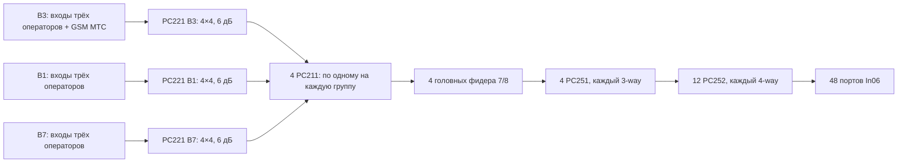

# Рабочий проект первого этажа

Дата: 12.10.2026. **Проверочный кандидат, не готовое решение для сдачи.** Разработаны CAD-подложка, координаты антенн, схема распределения, геометрические длины и спецификация. Нормировка пилота, ВК, полные характеристики компонентов и KPI остаются незакрытыми; уровень готовности указан в конце документа.

## Геометрия

Источник — оригинальный DWG из [source-materials](source-materials/README.md). INSUNITS = 4: миллиметры. Размеры переведены в метры, без подгонки под 2100 м². Подложка сопоставлена с исходным PNG.

В экспликации 46 помещений; итог 2097,06 м², сумма округлённых строк 2097,08 м². Разница с 2100 м² из ТЗ — 2,94 м². Для нагрузки сохраняется число пользователей задания, а не масштабирование по этой разнице. Знаменатель площади KPI ещё не установлен: нельзя автоматически объявить всю площадь чертежа, площадь прямоугольника или сумму служебных помещений обслуживаемой площадью.

Помещение 89, 45,52 м², есть в экспликации, но метка в model space не найдена. Обозначение ВК также не найдено; пользователь подтвердил отсутствие уточнения. Точка ввода около лотка в районе помещения 118 — проектное предложение; 118 обозначено как пожарный пост/диспетчерская и не переименовано в аппаратную.

Данные: [экспликация CSV](../../design/final/room-schedule.csv), [CAD-подложка](../../design/final/cad-floor.png), [происхождение геометрии](../../design/final/README.md).

## Секторизация и антенны

Кандидат — один общий LTE-пул с B3/B1/B7 и один DCS-пул с двумя TRX. Четыре группы фидеров Z1–Z4 не являются четырьмя независимыми LTE-секторами. Каждая LTE-несущая распределяется на все антенны одного пула. В пределах одной несущей нет собственных независимых co-channel ячеек, но сохраняются внешние помехи, многолучёвость и ограничения задержки распределения.

Выбрана In06 из XLSX: omni MIMO, 800–2700 МГц, 3 dBi, горизонтальная диаграмма 360°. In08 пока не используется из-за отсутствия частотного диапазона в строке перечня. Вертикальная диаграмма, port isolation и мощность In06 не предоставлены.

Для проверки распределения мощности приняты 48 проектных точек: 45 у найденных меток помещений и три дополнительные точки общественной зоны 101. Это исходный вариант для анализа, **не доказанный минимум и не окончательное размещение антенн**. Позиции текстовых меток не гарантируют центроиды помещений, пригодность крепления или отсутствие пересечения конструкций. Для технических и электрических помещений отдельно нужны допустимость установки и требования доступа. Помещение 89 пока не локализовано и не исключено из KPI без согласования.

Высота антенн в сценарии 7 м, UE 1,5 м. В каждой точке две независимые MIMO-цепи идут к двум портам одной In06; один порт не разветвляется на два входа как замена MIMO.

План: [PDF](../../design/final/candidate-layout.pdf), [PNG](../../design/final/candidate-layout.png). Координаты и группировка: [CSV](../../design/final/antenna-schedule.csv). Полная структура: [candidate.json](../../design/final/candidate.json).

## Соединения и три оператора

Схема на каждой MIMO-ветви:

Схема повторяется для второго MIMO-порта. Четыре выхода каждого гибридного комбайнера используются в четырёх группах. На выходе каждой группы один триплексер объединяет выходы B3/B1/B7 соответствующей ветви. **6 дБ PC221 уже включают передачу с одного входа на один из четырёх выходов**; дополнительное головное деление 4-way не добавляется и повторное вычитание 6 дБ не выполняется.

GSM-пул через один PC250 делится на два входа B3-гибридов. Это не GSM MIMO; расчёт GSM дополнительно включает около 3,01 дБ идеального 2-way деления и excess loss. Совместная работа DCS/LTE-1800 требует ARFCN/EARFCN, изоляции и PIM-проверки; одно наличие комбайнера этого не подтверждает.

Общее количество: 6 PC221, 8 PC211, 8 PC251, 24 PC252, 1 PC250, 48 In06. Источники БС, baseband и лицензии не выбираются из отсутствующих данных. Для двух других операторов предусмотрены входы, но их полосы, число секторов, мощности и нагрузки не выдуманы.

Четвёртые входы B1/B7-гибридов не используются; до подключения других операторов свободны также их зарезервированные входы. Нужны согласованные нагрузки 50 Ом или иное паспортно допустимое окончание. Нагрузок в перечне нет: это открытый вопрос комплектации, а не добавленная неразрешённая позиция. Номинал 4×4 из XLSX не заменяет паспорт матрицы передачи, согласования и развязки.

## Трассы и количества

Проектная сеть построена по координатам CAD-слоя E-CABL-TRAY-CNTR. Повороты и местные соединения аппроксимированы прямыми; это не утверждение о точной доступности всех лотков. На чертеже различаются лотки СБ, СКС и АППЗ; их совместное использование и заполнение требуют проверки. Соединение разных трасс не считается автоматически разрешённым.

Ответвления идут к ближайшей точке предложенной сети; остальная часть маршрута — по сети лотков. Группы по четыре антенны выбраны перебором разбиений с минимизацией суммарной длины участков на схематизированной сети. Это оптимизация геометрической длины при фиксированной топологии, не глобальная оптимизация стоимости, покрытия или худших потерь. Высотные спуски и обходы конструкций пока не установлены.

Во всём этаже две MIMO-ветви:

- 44 участка 7/8 (головные, подгрупповые и оконечные длиннее 15 м); геометрическая длина 1272,390548 м;
- 84 коротких оконечных участка 1/2; суммарная длина 576,645238 м;
- 88 разъёмов 4.3-10 для 7/8, 168 для 1/2 — по два на участок;
- закупочный резерв фидеров 10%, отдельно от длин в радиобюджете: 1400 м 7/8 и 635 м 1/2;
- 141 джампер 3 м с учётом трёх операторов: 18 LTE-входов + 1 GSM-вход + 2 связи после PC250 + 24 связи PC221→PC211 + 96 антенных. При подключённом только МТС 12 входных джамперов зарезервированы.

Фидеры подключаются непосредственно через свои разъёмы к распределителям; антенный джампер учтён отдельно. Фактические порты БС, переходники и пригодность 3-метровых головных связей не подтверждены. Пожарное исполнение из XLSX и PDF расходится. Количества являются проверочным вариантом, не заказом оборудования.

## RF-проверка кандидата

Применена условная нормировка пилота P1 из [rsrp-calculation.md](rsrp-calculation.md). Для LTE-ветви:

L_RF = 6 (PC221, перечень) + 1 (PC211, допущение) + 10log10(12) (идеальное деление PC251→PC252) + 1 (excess loss двух стадий, допущение) + 0,8 (соединения, допущение) + 1 (джамперы, допущение) + L_cable.

Фиксированная часть 20,59181246 дБ. Кабели — по длинам схемы и паспортным коэффициентам; 2100/2600 для 1/2 интерполированы. Коэффициенты температуры/запас 7/8 ±5% пока не включены в номинальный результат и могут ухудшить худший путь.

После оптимизации длин и перехода длинных участков на 7/8 номинальные RF-потери 23,08–30,96 дБ. Худшая LTE-ветвь B7 — A41. При n = 2,5, без стен, в 20 м её RSRP около **−98,64 дБм**, ниже −90. На той же ветви до замены кабелей было −104,17 дБм: улучшение 5,53 дБ. Порог не обязан выполняться на 20 м от каждой антенны, если точка обслуживается другой антенной; для площади нужна отдельная пространственная проверка.

Переход на 7/8 всех подгрупповых и оконечных участков длиннее 15 м — собственное проектное решение для снижения потерь; 15 м не задано организаторами. Механические радиусы изгиба и возможность укладки более толстого фидера требуют проверки. Итоговый номинальный результат остаётся неуспешным на 20 м в этом сценарии; повышение мощности или смена нормировки без основания не используется.

Диагностическое поле [B7 без стен](../../design/final/rsrp-b7-no-walls.png) берёт сильнейшую антенну. Оно не включает маску обслуживаемой площади, стены и внешние помехи, не учитывает когерентное сложение сигналов общего пула и не является подтверждением KPI. Best Server LTE при одном пуле — одна ячейка, а не 48 разных серверов.

Следующие улучшения нужно оценивать после уточнения пилота: сокращение/перенос ветвей, 7/8 на длинных участках, неравномерное деление по требуемой мощности, уменьшение числа антенн по реальному покрытию, разделение на независимые источники с расчётом помех. Увеличивать мощность выше заданных ограничений или выбирать благоприятную нормировку без основания нельзя.

## Статус готовности

Проверены арифметика, структура дерева, соответствие моделей перечню, координатная основа, геометрические длины и условные RF-точки. Подготовлена [спецификация XLSX](../../equipment/bill-of-materials-draft.xlsx) и [презентация PPTX](../../presentation/defense-draft.pptx).

**Для сдачи проект пока не готов.** Незакрыты: ВК; помещение 89 и область KPI; монтаж антенн; нормировка 23 дБм; паспорта компонентов/нагрузки портов; пожарное исполнение; удалённое регулирование; карты RSRP с препятствиями, RSRQ, SINR и DCS; UL и задержки общей DAS. Пассивная схема из текущего перечня не подтверждает буквальное требование регулировки на удалённых модулях. Документы следует использовать как проверочный пакет, затем исправить конкретные несоответствия, а не отправлять как подтверждённое финальное решение.
