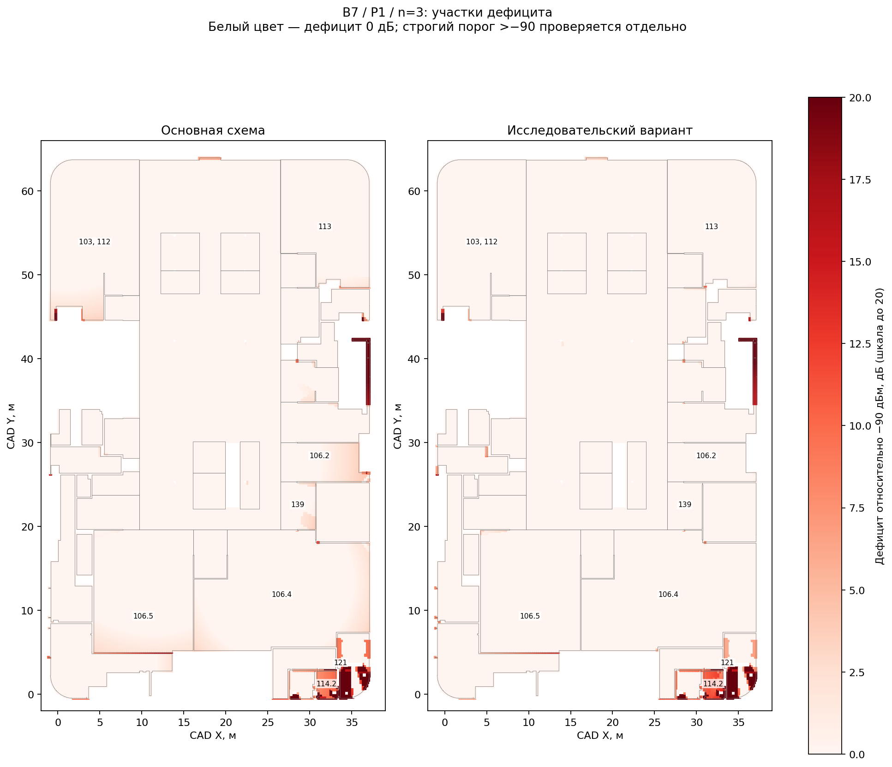
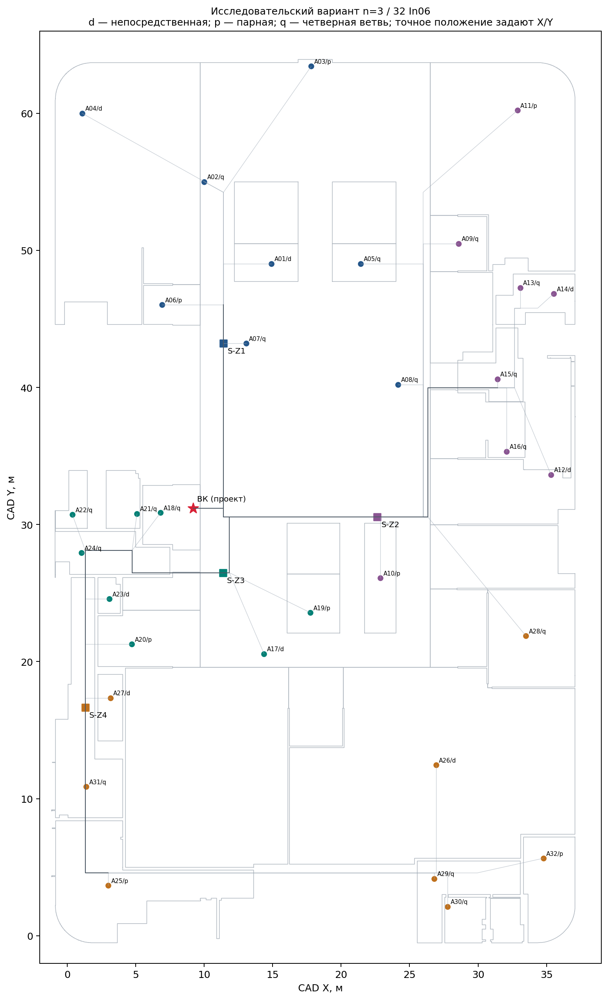
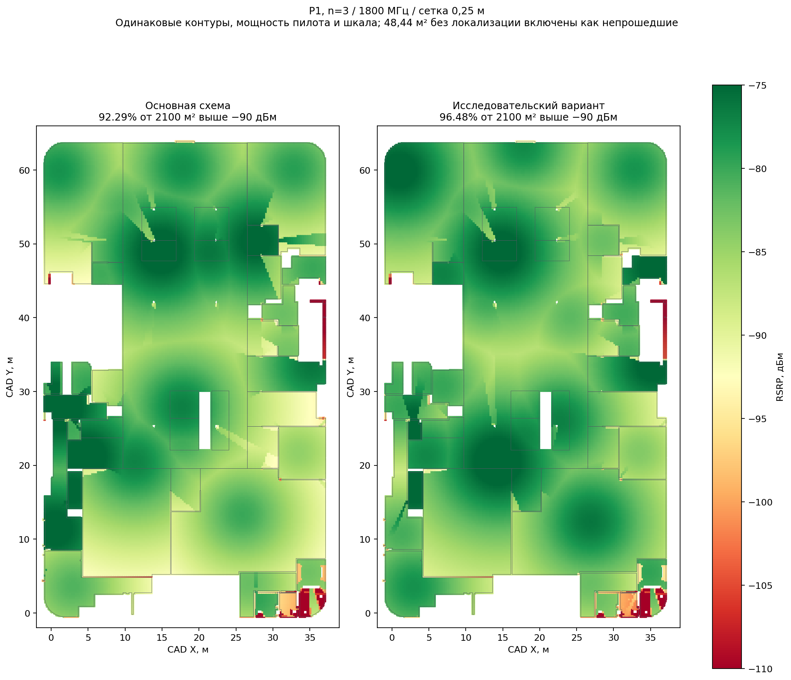
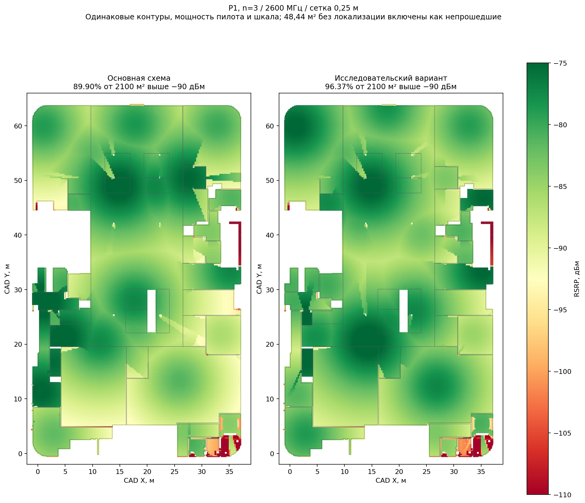

# Возможность выполнения RSRP при n=3

**Статус принятия:** Вариант принят в основной проект; пять артефактов и архив обновлены. [Запись принятия](../../design/final/n3/primary-adoption.json).

Дата: 13.10.2026. Исследование выполнено отдельно от основного пакета. Исходные DOCX, геометрия и архив сдачи не изменены.

## Результат

Найден полностью трассированный пассивный вариант с **32 In06** и прежней мощностью пилота. На сетке **0,25 м** он проходит RSRP >−90 дБм на ≥95% от 2100 м² при n=3 во всех трёх диапазонах. Совместная проверка n=2,5 с закрытыми проёмами, 114.2 как непрошедшим и дополнительными 3 дБ также проходит. Это результат условной модели P1, не измерения и не подтверждение всех KPI. В таблицах «основная схема» означает зафиксированную версию до принятия.

| Диапазон | Основная схема n=3 | Новый вариант n=3 | Новый: проёмы/контур/+3 дБ |
| --- | --- | --- | --- |
| 1800 МГц | 92,29% | 96,48% | 96,35% |
| 2100 МГц | 91,35% | 96,45% | 96,35% |
| 2600 МГц | 89,90% | 96,37% | 96,32% |

## Данные задания и принятые допущения

Источники: [задание финала](task.docx), [основная модель покрытия](coverage-review.md), [проверка RF-бюджета](rsrp-calculation.md), предоставленный перечень оборудования.

**Данные задания:** пилот 23 дБм на БС, потолок 7 м, перегородки 15 дБ, внешние стены/ЖБ колонны 30 дБ, полосы B3/B1/B7 20/15/10 МГц; критерий RSRP >−90 дБм на 95%.

**Выбор из перечня:** In06, потолочная omni MIMO, 800–2700 МГц; указано усиление 3 dBi. Его использование как номинального усиления без вертикальной диаграммы остаётся допущением.

**Собственные допущения:** P1 — сумма 2N_PRB CRS-поднесущих в CRS-символе на одном порту; высота UE 1,5 м, G_UE=0, G_In06=3 dBi; идентификация препятствий и экспликационные веса прежние. n=3 — сценарий чувствительности, не отдельное требование задания. Пассивные excess loss, местные джамперы и пригодность лотков сохраняют прежнюю условность. Материал, вертикальная диаграмма, фактическая ВК и монтажная доступность не установлены.

**Критерий этого исследования:** пройти n=3 и сохранить ≥95% совместного сценария запаса; не повышать мощность, не менять геометрию и знаменатель. 45,52 м² помещения 89 и ещё 2,92 м² до 2100 включены как непрошедшие. 114.2 не исключена из площади.

Вес ячейки w_i = (a_i/A_model,group)×A_reference,group по экспликации. Сумма весов 2051,56 м²; неизменный знаменатель 2100 м². Это модельная экстраполяция, не подтверждение достоверности всех контуров. Масштаб координат не изменяется.

Формулы: P_CRS_RE = 23−10log10(2N_PRB); L_n = 20log10(f_MHz)−27,55+10n log10(r_m); RSRP_i = P_CRS_RE−L_RF,i+3−L_n−L_walls,i−L_columns,i; r = √(d²+5,5²). Выбран сильнейший отдельный путь; фазовое сложение не учитывается. Доля = 100×Σw[RSRP>−90]/2100. Изменение n=2,5→3 добавляет 5log10(r) дБ потерь, а не постоянные 3 дБ.

## Где возникал дефицит

Исходный B7 не проходит на 212,07 м², включая 48,44 м² нелокализованной площади. Для достижения 95% требовалось дополнительно покрыть 107,07 м² при прежнем знаменателе.

| Помещения | Непрошедшие м² | Среднее r, м | Стены, дБ | RF-потери, дБ |
| --- | --- | --- | --- | --- |
| 106.4 | 42,90 | 11,72 | 0,00 | 24,28 |
| 106.5 | 34,26 | 15,24 | 0,64 | 20,41 |
| 106.2 | 22,69 | 16,90 | 0,03 | 20,33 |
| 103, 112 | 19,57 | 14,41 | 0,20 | 21,93 |
| 121 | 10,13 | 7,44 | 25,43 | 25,84 |
| 114.2 | 8,42 | 7,13 | 16,05 | 23,77 |
| 113 | 6,65 | 12,39 | 0,17 | 23,14 |
| 139 | 5,37 | 13,98 | 0,00 | 22,65 |

Средние относятся к сильнейшему пути на провальных ячейках, взвешены по площади; они описывают бюджет, а не доказывают единственную причину. В 106.4/106.5/106.2 основной вклад давали расстояние и RF-потери; в 121 и 114.2 существенны пересечения препятствий.



## Что изменено

ВК оставлена в проектной точке части 104.2, (9,2;31,2) м. Перенесены S-узлы по предложенному графу лотков; координаты ниже — модельные точки, не согласованные места установки. На каждом S остаются отдельные PC252 для M1/M2.

| Узел | Прежние X/Y, м | Новые X/Y, м |
| --- | --- | --- |
| S-Z1 | 11,409 / 49,000 | 11,409 / 43,211 |
| S-Z2 | 25,988 / 49,000 | 22,638 / 30,542 |
| S-Z3 | 11,839 / 30,542 | 11,373 / 26,486 |
| S-Z4 | 1,315 / 12,000 | 1,315 / 16,642 |

Дерево 2+2+4 сохранено: две непосредственные антенны, две через PC250 и четыре через PC252. Идеальные зональные доли 2×1/4+2×1/8+4×1/16=1. Выходы головного PC221 по-прежнему делят мощность между четырьмя зонами; два MIMO-порта физически отдельны. Мощности антенн не суммируются как новые источники.

| ID | Прежняя привязка | Новая привязка | Класс мощности | Новые X/Y, м |
| --- | --- | --- | --- | --- |
| A03 | 101 | 101 | pair → pair | 17,815 / 63,424 |
| A04 | 112 | 112 | pair → direct | 1,091 / 59,995 |
| A05 | 111 | 111 | direct → quartet | 21,437 / 49,024 |
| A06 | 135 | 135 | quartet → pair | 6,919 / 46,021 |
| A08 | 131 | 131 | quartet → quartet | 24,156 / 40,211 |
| A09 | 107 | 107 | direct → quartet | 28,580 / 50,490 |
| A10 | 107.1 | 125 | quartet → pair | 22,860 / 26,095 |
| A14 | 118 | 118 | pair → direct | 35,524 / 46,836 |
| A17 | 108.1 | 108.1 | pair → direct | 14,373 / 20,568 |
| A18 | 133 | 104.2 | pair → quartet | 6,815 / 30,861 |
| A19 | 134 | 134 | quartet → pair | 17,756 / 23,568 |
| A20 | 106.6 | 106.6 | direct → pair | 4,711 / 21,268 |
| A23 | 124 | 124 | quartet → direct | 3,070 / 24,580 |
| A24 | 127 | 127 | direct → quartet | 1,035 / 27,933 |
| A25 | 117 | 117 | quartet → pair | 2,984 / 3,667 |
| A26 | 106.4 | 106.4 | pair → direct | 26,935 / 12,451 |
| A27 | 128 | 128 | direct → direct | 3,145 / 17,345 |
| A30 | 114.1 | 114.1 | pair → quartet | 27,774 / 2,132 |
| A31 | 116 | 116 | direct → quartet | 1,382 / 10,868 |
| A32 | 121 | 121 | quartet → pair | 34,765 / 5,653 |

Номер помещения — исходная привязка/целевая зона. Для объединённых CAD-групп он не удостоверяет нахождение новой позиции в отдельной комнате. Все точки проверены внутри соответствующих восстановленных групп. Полный журнал локальных переносов — moves.json.



## Сравнение полностью трассированных вариантов

| Вариант | B7 n=3 | B7 совместный +3 дБ | Коаксиал, м |
| --- | --- | --- | --- |
| Основная схема | 89,90% | 96,11% | 1461,31 |
| Только новые S-узлы | 89,91% | 95,80% | 1400,92 |
| Только распределение мощности | 94,16% | 95,68% | 1541,00 |
| Узлы, мощности и замены; без локальных переносов | 96,17% | 96,22% | 1401,23 |
| Полный исследовательский вариант | 96,37% | 96,32% | 1403,72 |

Контроли «только узлы» и «только мощности» переносят соответствующие решения финального кандидата на прежнее размещение. «Без локальных переносов» сохраняет выбранные узлы, мощности и заменённые исходные позиции, но отменяет 9 локальных смещений. Это самостоятельные абляционные варианты, не результаты их отдельной оптимизации. Для каждого заново рассчитаны подгрупповые узлы и маршруты.

## Комплектация и цена изменения

| Позиция | Основная схема | Исследовательский вариант |
| --- | --- | --- |
| In06 | 32 | 32 |
| PC221 | 6 | 6 |
| PC211 | 8 | 8 |
| PC250 | 9 | 9 |
| PC252 | 16 | 16 |
| 7/8 установленный, м | 1196,03 | 1241,38 |
| 1/2 установленный, м | 265,29 | 162,34 |
| 7/8 закупочный, м | 1316 | 1366 |
| 1/2 закупочный, м | 292 | 179 |
| Разъёмы 7/8 | 84 | 100 |
| Разъёмы 1/2 | 84 | 68 |
| Джамперы 3 м | 113 | 113 |

Все количества рассчитаны для двух MIMO-ветвей. Общий коаксиал 1461,31 → 1403,72 м (-3,94%). Закупочные длины: ceil(1,10×установленная). Два разъёма на каждый изготовляемый участок; заводские местные джамперы не считаются нулевыми фидерами. Цены не заданы, экономический оптимум не заявляется. Потребность в нагрузках свободных портов и неподтверждённые интерфейсы/исполнения кабеля сохраняются.

## Контроль точности и ограничения

| Диапазон | Новый n=3, шаг 0,5 м | Новый n=3, шаг 0,25 м | Новый n=3 с проёмами | P2, n=2,5 |
| --- | --- | --- | --- | --- |
| 1800 МГц | 96,37% | 96,48% | 96,12% | 94,49% |
| 2100 МГц | 96,33% | 96,45% | 96,02% | 93,52% |
| 2600 МГц | 96,23% | 96,37% | 95,85% | 91,68% |

Проверены независимая сумма сегментов каждого маршрута, потери всех путей на трёх частотах, сохранение идеальных долей мощности, совпадение базового n=3 с основным отчётом и неизменность геометрии. Сетка 0,25 м содержит 35522 ячейки; 0,5 м — контроль дискретизации, не калибровка физической модели.

Число антенн увеличивать для найденного решения не потребовалось; минимальность 32 не доказана. Поиск ограничен 48 исходными позициями с текущими смещениями, 420 распределениями на зону, двумя проходами замен и локальной сеткой ±3 м/центром группы. В каждой зоне выбраны 8 из 12 исходных позиций; межзональные замены в выполненном поиске не применялись. Узлы проверены в конечном наборе проекций на предложенные лотки; глобальный оптимум не установлен.

P2 остаётся отдельным ограничением нормировки мощности. SINR/RSRQ/C/I, UL, MIMO rank, вертикальная диаграмма, нагрузки, PIM, мощности оборудования и пожарное исполнение не подтверждены. Пассивная схема не обеспечивает буквально требуемое удалённое регулирование. Новые измерения или паспорта не выдуманы. Независимые источники по зонам либо активная/гибридная DAS остаются отдельной архитектурной альтернативой при требовании более слабого питания; их преимущества и соответствие пассивному ТЗ здесь не доказаны.

## Карты и воспроизведение






Данные: design/final/n3/verification.json, group-comparison.csv, baseline-diagnostics.csv; входы — best32-project-input.json, трассированный кандидат — best32-candidate.json. verified-fields.npz содержит итоговые поля двух вариантов; PNG/PDF карт имеют одинаковые шкалы.

Из корня репозитория с установленными requirements.txt:

```sh
MPLCONFIGDIR=/tmp/radio-mpl OPENBLAS_NUM_THREADS=1 python scripts/final/research_n3.py --passes 2
MPLCONFIGDIR=/tmp/radio-mpl OPENBLAS_NUM_THREADS=1 python scripts/final/review_n3.py
```

Исследовательские кэши находятся вне репозитория. Основные пять артефактов не заменяются этими командами. Проверенный вариант перенесён в основной проект; состояние экспорта фиксируется в primary-adoption.json.
