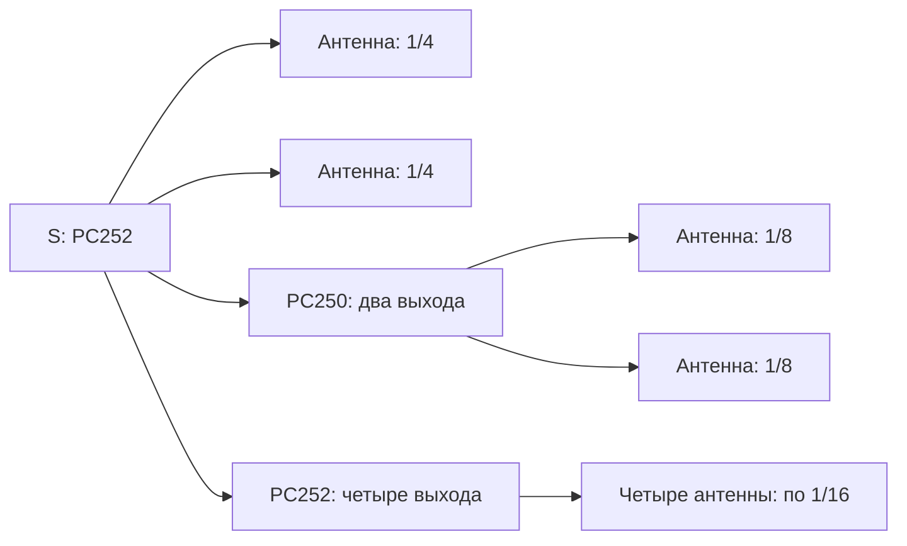

# Как разобраться в решении и подготовить защиту

Цель — объяснить каждое число в шести слайдах, показать его источник и
назвать границы применимости. Расчётные прогнозы не являются измерениями.

## 1. Общая схема задачи

Заказчик задаёт площадь 2100 м², посещаемость 500 человек в ЧНН,
скорость LTE DL 8 Мбит/с и пороги покрытия. Связь расчётов:
спрос пользователей → ёмкость БС → распределение радиосигнала по этажу.
Антенны распределяют сигнал; их число не задаёт число независимых
секторов и не добавляет ёмкость общему пулу.

| Термин | Значение в проекте |
| --- | --- |
| UE | Пользовательское устройство |
| ЧНН | Час наибольшей нагрузки |
| RRC Connected | Устройство имеет радиосоединение; это не обязательно непрерывная передача данных |
| Buffer user | Пользователь с данными в буфере, которому нужен радиоресурс |
| B3/B1/B7 | LTE 1800/2100/2600 МГц; полосы МТС 20/15/10 МГц |
| RF-пул | Общий радиоресурс, сигнал которого распределяется по нескольким антеннам |
| DAS | Распределённая антенная система |
| MIMO 2×2 | Два отдельных передающих тракта; два пространственных потока требуют подходящего радиоканала |
| CA | Агрегация несущих; без неё остатки ресурса полос нельзя складывать для одного UE |

Прочитать: [задание](../docs/final/task.docx), [ёмкость](../docs/final/capacity-revision.md).

## 2. Воспроизвести ёмкость

1. Прогноз устройств МТС: 500×0,60×1,20×f₄G; при авторском f₄G=1 это 360 UE.
2. RRC-подключения: 360×0,35=126 UE.
3. Пользователи с данными: 126×0,10=12,6 → округление вверх до 13 UE.
4. Спрос DL: 13×8=104 Мбит/с.
5. Вместимость несущей: C=полоса×η×u; η=3,1505922 бит/с/Гц,
   u=0,8 — авторские допущения.

| Диапазон | C, Мбит/с | Полные UE по 8 Мбит/с без CA |
| --- | --- | --- |
| B3 | 50,4095 | floor(50,4095/8)=6 |
| B1 | 37,8071 | floor(37,8071/8)=4 |
| B7 | 25,2047 | floor(25,2047/8)=3 |

Итого 13 UE при подходящих терминалах и балансировке. На 14-го UE без CA
ресурса нет. Среднее число UE не даёт гарантии обслуживания пиков.
Онлайн-модель считала 360×80%=288 UE. Новые RRC/buffer заменяют прежнюю
одновременность. Для одного общего пула принято k(1)=1: нет перекоса
между секторами. Это изменение авторского допущения; сохранение k=1,10
даёт два сектора.

Самопроверка: объяснить переход 25 → 1 и условия достаточности одного пула.

## 3. Проследить RF-путь

В [проекте](../submission/final/02-floor-design.pdf) и листе «Портовый план»
[спецификации](../submission/final/04-equipment.xlsx) проследить:
LTE TX-порт → PC221 → PC211 → S-Z → антенна. Для второго TX-порта
повторить путь по отдельному дереву.

PC221 распределяет сигнал на четыре зоны. PC211 объединяет разные
диапазоны в один фидер данной ветви. В зоне PC252 делит мощность 2+2+4:

Идеальные доли: 2×1/4+2×1/8+4×1/16=1. Повышение мощности части ветвей
оплачено снижением на других. Кабели и дополнительные потери учитываются
отдельно. Z1–Z4 — распределительные группы одной ячейки на диапазон.

Самопроверка: найти A28, два её порта, класс мощности и трассу;
объяснить, почему два MIMO-порта нельзя объединить в одно дерево.

## 4. Понять RSRP

RSRP — мощность одного reference-signal RE. Полная мощность LTE-несущей
и заданная мощность пилота не равны автоматически RSRP.
В условном P1: P_RE=23−10log₁₀(2N_PRB). Для B7 N_PRB=50,
поэтому P_RE=3 дБм. Далее:
RSRP=P_RE−L_RF+G_ant−L_распространения−L_препятствий+G_UE.

При высотах 7/1,5 м r=√(d²+5,5²). Модель потерь:
20log₁₀(f_МГц)−27,55+10n·log₁₀(r_м). Больший n означает большее
затухание при r>1 м. Перегородка добавляет 15 дБ, пересечённая внешняя
стена или условная ЖБ колонна — 30 дБ. Усиление In06 3 dBi взято из
перечня, но вертикальная диаграмма и материалы всех препятствий неизвестны.

В [03-rsrp.pdf](../submission/final/03-rsrp.pdf) повторить пример A28/B7.
На горизонтальных 20 м один путь без стен даёт около −95,64 дБм.
Карта рассматривает все антенны в каждой точке: уровень одного пути
не равен доле покрытия этажа. Использован максимум отдельных путей;
фазовое сложение не моделируется и нижняя граница реального сигнала не доказана.

## 5. Различать проверки и гарантии

В [отчёте покрытия](../docs/final/coverage-review.md) сравнить P1, n=3,
закрытые проёмы, +3 дБ и P2. n=3 и +3 дБ проверялись отдельно;
их одновременное сочетание не заявляется прошедшим.

Доля считается по весам экспликации со знаменателем 2100 м².
Помещение 89 и нераспределённая площадь непрошедшие. 95% площади
не означает 95% каждой комнаты или покрытие всех точек.
P1 проходит проверенные RSRP-сценарии; более слабая трактовка P2 не проходит 95%.

RSRP не даёт автоматически SINR: нужны сигнал, помехи и шум;
для RSRQ нужен также RSSI. DL не доказывает UL. Две RF-ветви
подтверждают структуру MIMO, но не фактический rank 2.

Прочитать [ведомость KPI](../docs/final/kpi-checklist.md) и
[допущения](../docs/final/assumptions.md). Уметь назвать несоответствие
удалённого регулирования и пробелы комплектации: нагрузки, интерфейсы,
пожарное исполнение, мощности/PIM.

## 6. Репетиция

| Проход | Задача | Критерий |
| --- | --- | --- |
| Изучение | Объяснить слайды своими словами, сверяя PDF/XLSX | Для числа известны источник, формула и допущения |
| Доклад | Пройти [текст выступления](speaker-script.md) с таймером | Уложиться в 4 минуты, сохранить решения и ограничения |
| Вопросы | Ответить на [вопросы жюри](jury-questions.md) без чтения | Ответы по 20–40 секунд; при необходимости показать расчёт |
| Проверка PPTX | Открыть на компьютере выступления | Корректные шрифты, переносы и личные сведения |

Если доклад длиннее четырёх минут, сокращать подробности формул,
сохраняя изменение нагрузки, схему, результат покрытия и ограничения.
Плановый тайминг не заменяет реальную репетицию.

Личные сведения — в [profile-input.json](profile-input.json).
После редактирования пересобрать презентацию и пакет. Сдача —
**14.10.2026, 23:59 МСК**. Проверить принятие актуального архива платформой
и сохранить локальную копию отправленного ZIP.

## Качество сигнала и подготовка допущений

В обновлённом решении SINR/RSRQ/C/I представлены сценарно. Все параметры и формулы — в 03-rsrp.pdf; карты — в 02-floor-design.pdf. Параметры неизвестных помех задаются суммарным уровнем на входе UE. RSRQ учитывает оба TX-порта. Нельзя заменять его формулой для одного порта или считать антенны одной ячейки независимыми помеховыми секторами.

[Карточка защиты допущений](assumptions-defense.md) содержит короткие ответы; [подробные вопросы](jury-questions.md) объясняют границы модели.
